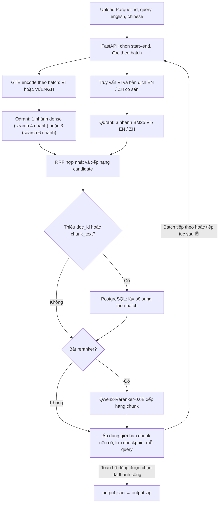

# SBTC AIGuru

Hệ thống truy hồi tài liệu và đoạn văn y khoa Việt–Anh–Trung cho R2AI 2026.
Upload file Parquet, chọn phạm vi xử lý và tải kết quả `output.zip`.

## Pipeline



Pipeline giữ nguyên ID và thứ tự truy vấn. Mặc định bỏ qua Qwen để ưu tiên recall;
kết quả gồm `id`, `relevant_docs`, `relevant_chunks` với `doc_id`, `chunk_text`.
ID query và tài liệu đều xuất dạng **số nguyên JSON**.
Tác vụ còn lỗi chưa xuất ZIP.

## Chạy giao diện

Từ thư mục gốc dự án, dùng môi trường `.venv` hiện có:

```bash
.venv/bin/python -m uvicorn BackEnd.app.api.main:app --host 127.0.0.1 --port 8000 --workers 1
```

Mở [giao diện](http://127.0.0.1:8000) hoặc [Swagger API](http://127.0.0.1:8000/docs).
Frontend nằm trong `FrontEnd`, được FastAPI phục vụ trực tiếp, không cần build.

- Upload `query_translated.parquet` có các cột `id`, `query`, `english`, `chinese`.
- Start–end tính theo dòng từ **1**, gồm cả hai đầu; để trống để chạy hết file.
- Chọn **search 4/6 nhánh**, bật/tắt **Qwen reranker** ngay trên UI. Phần giới hạn cho phép đổi ứng viên/nhánh, top-k và số chunk xuất ra; để trống số chunk để giữ hết.
- Mặc định **16 truy vấn/batch**, **100 ứng viên/nhánh → tối đa 200 sau fusion**, giữ mọi chunk sau khử trùng lặp, không qua reranker. Có thể tạm dừng và tiếp tục từ checkpoint với cùng cấu hình.
- Tác vụ lưu tại `artifacts/api-jobs/<job-id>/`, vẫn giữ sau khi đóng trang hoặc restart server.
- Lựa chọn lưu riêng theo từng job và giữ nguyên khi resume, kể cả sau restart server.

Có thể chạy trực tiếp bằng CLI:

```bash
.venv/bin/python -m BackEnd.app.pipeline query_translated.parquet \
  --output artifacts/pipeline/output.json --zip artifacts/pipeline/output.zip
```

## Cấu hình cần có

- `QDRANT_URL`, `QDRANT_COLLECTION`: collection đã nạp dữ liệu **hybrid GTE + BM25**.
- `DATABASE_URL`: PostgreSQL để bổ sung dữ liệu thiếu trong payload Qdrant.
- Chỉ cần model GTE trong chế độ mặc định; Qwen không được nạp hoặc chạy.
- Bật lại Qwen bằng `PIPELINE_RERANK=1` cho API hoặc `--rerank` cho CLI; thêm `PIPELINE_MAX_CHUNKS=50` hoặc `--max-chunks 50` nếu muốn chọn 50 chunk.
- `PIPELINE_RERANKER_DEVICE=cuda:0` chọn GPU cho Qwen khi bật; mặc định theo `PIPELINE_DEVICE` (`cpu`).
- Model cần dùng phải có đúng revision trong cache. Có thể đặt `PIPELINE_MODEL_CACHE`;
  pipeline tự nhận `artifacts/model-cache` nếu đã tải tại đó.

Chọn chế độ trước khi tạo job mới; resume dùng cấu hình đã lưu của job đó.
Sau cập nhật này cần restart API và tạo job mới: checkpoint cũ dùng ID chuỗi
không dùng chung với định dạng ID số nguyên.

Chi tiết: [Pipeline](BackEnd/app/PIPELINE.md) · [API và checkpoint](BackEnd/app/api/README.md) · [BM25 riêng](BackEnd/app/Retrieval/README.md).

## Hẹn tắt máy lúc 03:00

```bash
bash Scripts/shutdown_at_0300.sh --dry-run  # Xem giờ dự kiến, chưa đặt lịch
sudo bash Scripts/shutdown_at_0300.sh       # Đặt lịch một lần, giờ Việt Nam
bash Scripts/shutdown_at_0300.sh --status   # Xem lịch
sudo bash Scripts/shutdown_at_0300.sh --cancel
```

Script dừng API của dự án trước một phút, chờ tối đa 45 giây rồi ngắt nếu còn kẹt,
sau đó yêu cầu tắt máy lúc 03:00. Checkpoint/output đã lưu vẫn còn. Có thể đóng
terminal sau khi đặt lịch; máy cần đang thức. Lịch không lặp hằng ngày và mất sau reboot.
