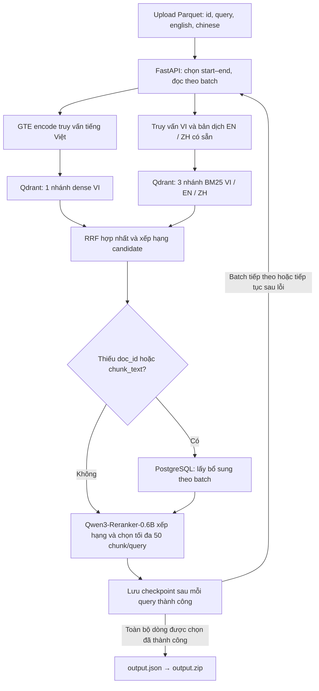

# SBTC AIGuru

Hệ thống truy hồi tài liệu và đoạn văn y khoa Việt–Anh–Trung cho R2AI 2026.
Upload file Parquet, chọn phạm vi xử lý và tải kết quả `output.zip`.

## Pipeline



Pipeline giữ nguyên ID và thứ tự truy vấn. Qwen chạy cục bộ, chỉ xếp hạng chunk nguồn;
kết quả gồm `id`, `relevant_docs`, `relevant_chunks` với `doc_id`, `chunk_text`.
Tác vụ còn lỗi chưa xuất ZIP.

## Chạy giao diện

Từ thư mục gốc dự án, dùng môi trường `.venv` hiện có:

```bash
.venv/bin/python -m uvicorn BackEnd.app.api.main:app --host 127.0.0.1 --port 8000 --workers 1
```

Mở [giao diện](http://127.0.0.1:8000) hoặc [Swagger API](http://127.0.0.1:8000/docs).
Frontend nằm trong `FrontEnd`, được FastAPI phục vụ trực tiếp, không cần build.

- Upload `query_translated.parquet` có các cột `id`, `query`, `english`, `chinese`.
- Start–end tính theo dòng từ **1**, gồm cả hai đầu; để trống để chạy hết file.
- Mặc định **16 truy vấn/batch**, **50 chunk/query sau rerank**. Có thể tạm dừng và tiếp tục từ checkpoint.
- Tác vụ lưu tại `artifacts/api-jobs/<job-id>/`, vẫn giữ sau khi đóng trang hoặc restart server.

Có thể chạy trực tiếp bằng CLI:

```bash
.venv/bin/python -m BackEnd.app.pipeline query_translated.parquet \
  --output artifacts/pipeline/output.json --zip artifacts/pipeline/output.zip
```

## Cấu hình cần có

- `QDRANT_URL`, `QDRANT_COLLECTION`: collection đã nạp dữ liệu **hybrid GTE + BM25**.
- `DATABASE_URL`: PostgreSQL để bổ sung dữ liệu thiếu trong payload Qdrant.
- Qwen3-Reranker-0.6B có sẵn trong cache, không cần API key cho rerank.
- `PIPELINE_RERANKER_DEVICE=cuda:0` để dùng GPU; mặc định theo `PIPELINE_DEVICE` (`cpu`).
- Model GTE và Qwen đúng revision có sẵn trong cache. Có thể đặt `PIPELINE_MODEL_CACHE`;
  pipeline tự nhận `artifacts/model-cache` nếu đã tải tại đó.

Chi tiết: [Pipeline](BackEnd/app/PIPELINE.md) · [API và checkpoint](BackEnd/app/api/README.md) · [BM25 riêng](BackEnd/app/Retrieval/README.md).
