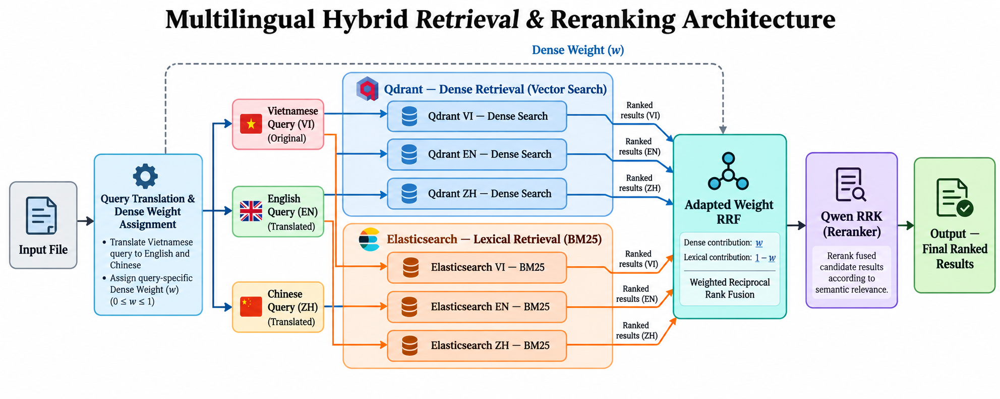

# SBTC AIGuru

A Vietnamese–English–Chinese medical retrieval system for R2AI 2026. It combines
semantic search and BM25, optionally reranks retrieved passages, and exports
ranked document IDs and original source chunks.

## System architecture



The diagram shows the full six-branch workflow. Translation, query-specific
weight assignment, and embedding are prepared **offline**. The runtime consumes
these inputs, retrieves candidates, applies adaptive weighted reciprocal rank
fusion (RRF), and optionally runs a local reranker.

| Mode | Dense search in Qdrant | BM25 in Elasticsearch |
| --- | --- | --- |
| `3-branch` | VI, EN, ZH queries | Disabled |
| `4-branch` (default) | VI query | VI, EN, ZH queries |
| `6-branch` | VI, EN, ZH queries | VI, EN, ZH queries |

Dense branches share one multilingual collection. BM25 searches language-specific
fields with matching language filters.

## Technical details

- **Dense retrieval:** Qwen3-Embedding-0.6B, 1,024-dimensional L2-normalized FP16
  vectors, cosine similarity, and an on-disk Qdrant HNSW index. The current
  snapshot uses `m=32`, `ef_construct=100`; search defaults to `hnsw_ef=512`.
  Existing 768-dimensional GTE inputs remain supported with a matching collection.
- **Lexical retrieval:** Elasticsearch BM25 with PyVi tokenization for Vietnamese,
  OpenCC Traditional-to-Simplified conversion plus SmartCN for Chinese, and an
  English analyzer that preserves medical terms and negations.
- **Fusion:** candidates are joined by their original `chunk_id`. Each query's
  `dense_weight` assigns weight `w` to dense retrieval and `1-w` to BM25, divided
  equally among each group's branches. Missing weights default to `0.5`.
  Dense-only mode uses equal weights of `1/3`.
- **Reranking:** optional Qwen3-Reranker-0.6B scores query–passage relevance
  locally. It is disabled by default; the pipeline does not generate medical answers.
- **Execution:** 100 candidates per branch, up to 200 after fusion, and 16 queries
  per batch by default. Successful queries are checkpointed individually;
  interrupted jobs resume with their saved configuration. PostgreSQL supplies
  missing source fields only when search payloads are incomplete.

## Run locally

Use the existing project environment and populated Qdrant/Elasticsearch indexes.
Configure `QDRANT_URL`, `QDRANT_COLLECTION`, `ELASTICSEARCH_URL`, and
`ELASTICSEARCH_INDEX`; set `DATABASE_URL` when source hydration is needed.
Dense-only mode does not require Elasticsearch.

```bash
.venv/bin/python -m uvicorn BackEnd.app.api.main:app \
  --host 127.0.0.1 --port 8000 --workers 1
```

Open [the upload UI](http://127.0.0.1:8000) or
[API documentation](http://127.0.0.1:8000/docs). FastAPI serves the frontend directly.

Upload a Parquet containing integer `id`, query text in `query` / `english` /
`chinese`, three precomputed vectors, and the expected embedding metadata. For
Qwen notebook outputs that replace text columns with vectors, also upload the
original query Parquet. No translation or embedding runs during upload.

CLI example for an input that already contains both text and vectors:

```bash
.venv/bin/python -m BackEnd.app.pipeline queries_with_embeddings.parquet \
  --search-mode 4-branch \
  --output artifacts/pipeline/output.json --zip artifacts/pipeline/output.zip
```

Use `--start 1 --end 5` for a small run. Add `--rerank` to enable the reranker
with its pinned weights already cached. Completed jobs export `output.zip`
containing `output.json`: `id`, `relevant_docs`, and
`relevant_chunks[{doc_id, chunk_text}]`. Jobs with unresolved query errors do not
produce a final ZIP.

## Evaluation

**100 queries per mode**, evaluated against the full **4,936,835-chunk**
collection on 28 October 2026, with reranking disabled. Reference passages
span Vietnamese (34), English (33), and Chinese (33); each query has frozen
VI/EN/ZH text, one reference document, and one verbatim reference passage.

| Mode | Doc Recall@5 | Doc Recall@10 | Doc F2@10 | Chunk Recall@10 | Chunk F2@10 |
| --- | ---: | ---: | ---: | ---: | ---: |
| `3-branch` | 71.00% | 76.00% | 0.2714 | 72.00% | 0.2782 |
| `4-branch` | 67.00% | 79.00% | 0.2821 | 77.00% | 0.2892 |
| `6-branch` | 76.00% | 82.00% | 0.2929 | 78.00% | 0.2988 |

Scores are macro-averaged across queries. Document cutoffs use unique ranked
document IDs; chunk cutoffs use ranked passages and the BTC token-LCS matching
rule. F2@10 uses the first ten results and is relative to the fixed references.

Settings: 100 candidates/branch, fused top-k 200, `hnsw_ef=512`, four workers,
batch size 16, and hybrid `dense_weight=0.5`.

| Mode | Median retrieval/query | p95 retrieval/query | Total run |
| --- | ---: | ---: | ---: |
| `3-branch` | 21.32 s | 28.81 s | 9.03 min |
| `4-branch` | 7.53 s | 12.89 s | 3.54 min |
| `6-branch` | 25.52 s | 32.03 s | 10.71 min |

Measured on an Intel Core i7-13650HX with 14.8 GiB RAM, Qdrant 1.19.2, and
Elasticsearch 9.5.1. Retrieval timing includes backend searches and fusion;
total run time also includes checkpointing and JSON/ZIP export. Query embedding
is prepared separately. Single-pass measurements include natural cache effects.

[Full-output F2, metric definitions, and protocol](BackEnd/tests/README_RETRIEVAL_QUALITY.md).

## Repository layout

| Path | Purpose |
| --- | --- |
| `BackEnd/app/pipeline.py` | Retrieval orchestration, checkpointing, and export |
| `BackEnd/app/Database/` | Database clients and embedding/snapshot notebooks |
| `BackEnd/app/Retrieval/` | Input validation, hybrid fusion, and reranking |
| `BackEnd/app/api/`, `FrontEnd/` | Upload API, job controls, and downloads |
| `Scripts/` | Data preparation, language labeling, and Kaggle workflows |
| `tests/` | Unit and integration checks |

Further details: [Pipeline](BackEnd/app/PIPELINE.md) ·
[API and checkpoints](BackEnd/app/api/README.md) ·
[Elasticsearch setup](BackEnd/app/Database/README.elasticsearch.md) ·
[Kaggle workflow](Scripts/Kaggle/Hybrid_Retrieval_Kaggle.md).
