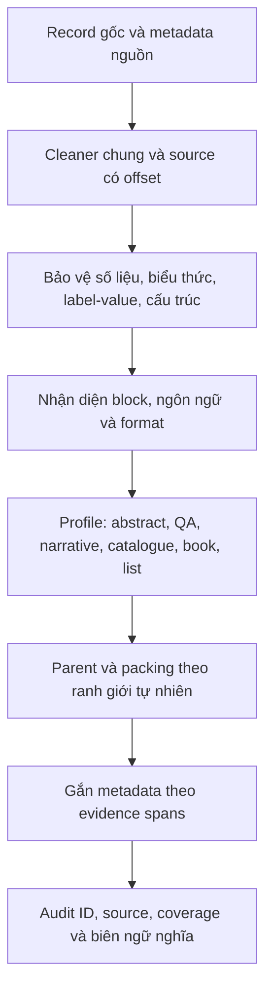

# Đề xuất chunking theo format cho ViBioMIR

Trạng thái: **ĐÃ DUYỆT — triển khai theo yêu cầu ngày 13/10/2026**.

Đã kiểm chứng `format-v1` ngày 14/10/2026 trên test20k: 68 tests hiện tại đạt,
full output audit 0 errors. [Báo cáo và giới hạn regression legacy](REPORT-format-aware-chunking-v1.md).

Kế hoạch: `tasks/format-aware/plan.md`; tiến độ: `tasks/format-aware/todo.md`.
Triển khai bằng strategy `format`, version `format-v1`, giữ `hybrid` để đối chiếu.
Phạm vi: component Preprocess; chưa triển khai profile hoặc thay đổi output API.
Bằng chứng: [REPORT-format-chunking-audit-20261013.md](REPORT-format-chunking-audit-20261013.md).
Case thật: [CASEBOOK.md](research/format-audit-20261013/CASEBOOK.md).

## 1. Mục đích và phương án chọn

Giữ khả năng xử lý lớn và kiểm toán của hybrid hiện tại, đồng thời cải thiện
biên cắt và ngữ cảnh theo cấu trúc tài liệu. Tối ưu phải xét hiệu quả retrieval,
độ nguyên bản và chi phí; chưa có căn cứ gọi profile nào là tối ưu về F2.

| Phương án | Ưu điểm | Nhược điểm | Đánh giá |
|---|---|---|---|
| Mở rộng một packer generic | Ít thay đổi, dễ giữ tương thích | Nhiều if/regex đan xen; khó tách bio, abstract, prescription | Dùng để sửa numeric/lead-in guards trước |
| Lõi span chung + router/profile | Giữ API và invariants; mỗi format có hành vi rõ, test được | Cần detector, fallback và version | **Khuyến nghị** |
| Semantic/LLM quyết định biên toàn bộ | Có thể nhận diện ngữ nghĩa khó | Chi phí trên 1,22M; reproducibility/provenance và model constraints | Chỉ nghiên cứu sau khi có ablation/gold, không chọn cho pha đầu |

Một format có nhiều domain; một domain có nhiều format. Domain/path là prior;
vai trò block, nhãn mục, ngôn ngữ và shape của text quyết định profile. Cùng
cleaner, protect spans, packer, audit và CLI phục vụ mọi profile, tránh các bản
chunker độc lập có hợp đồng bảo toàn khác nhau.

## 2. Input, output và bất biến

Input hiện hành: JSONL với `id` int nguyên bản, `url` str, `text` str,
`success` bool; `row_index` là provenance, không làm khóa.
Metadata đã có/thu thêm có thể cung cấp title/heading spans, nguồn, ngôn ngữ.
Không yêu cầu re-crawl để dùng profile cơ bản trên text hiện tại.

Output đã duyệt vẫn có document, parents, children, excluded_spans và cleaning
report. Các trường bổ sung trong schema nội bộ:

- Cấp document: `profile`, `profile_version`, `format_confidence`,
  `format_evidence`, `source_language`, `content_language_spans`.
- Cấp block/parent: `block_role`, `section_path`, `heading_spans`,
  `question_span`/`answer_span`, `list_item_span` hoặc `table_row_span` khi có.
- Cấp child: `profile`, `section_roles`, `content_languages`,
  `short_reason_evidence`, `boundary_reason`, `protected_span_checks`.
- Cờ theo nguồn: `duplicate_of_span`, `structure_lost`, `content_limited`,
  `format_unknown`, `oversized_sentence`/`oversized_structural_atom` khi có.

Bất biến:

1. `doc_id` giữ đúng ID trong manifest hiện hành. Không dùng giới hạn max ID
   lịch sử để loại PubMed; các ID PubMed hiện có thể >4.420.561.
2. Nguồn offset duy nhất là `source_text` của cleaner dùng chung. Chunk là
   một lát cắt liên tục chính xác, không ghép những span rời nhau.
3. Metadata/aliases/context dùng trong index không viết thêm vào `chunk_text`.
   File nộp chỉ theo schema `asked.md`, không thêm ICD/title/role vào text nộp.
4. Coverage gồm indexed+excluded =100%; mọi excluded span có bằng chứng,
   confidence, reason và source slice. Không xóa raw text.
5. Metadata ngữ nghĩa chỉ gắn theo span/bối cảnh thực sự; bệnh trong bio
   bác sĩ không thành bệnh của Q&A.

## 3. Luồng xử lý đề xuất

Detector phải xuất evidence offsets/reason; `high/medium/low` là confidence
heuristic cho tới khi được hiệu chỉnh trên nhãn review. Format không chắc dùng
fallback narrative/sentence, giữ nội dung và cảnh báo. Không rẽ profile chỉ
vì text có một keyword hoặc URL thuộc một domain.

## 4. Chính sách biên chung cần sửa trước

### 4.1. Bảo vệ biểu thức

Bảo vệ số thập phân dot/comma, hàng nghìn, tỷ lệ `1:1`, liều+đơn vị, khoảng số,
giá trị thống kê+CI/P-value, tên/mã y sinh, ngày/giờ và dấu ngoặc trong biểu
thức. Không cắt tại separator bên trong protected span; không coi `24.7mg`
là heading đánh số. Dùng bối cảnh địa phương để phân biệt `1,2,3` là danh sách
với số, không cấm mọi comma toàn tài liệu.

### 4.2. Ưu tiên câu hoàn chỉnh

Thay chính sách hiện tại chia clause khi câu >50 units bằng sentence atoms
cho quyết định biên chunk. Câu vừa ngân sách phải giữ toàn câu. Target overlap
30–50 là ưu tiên sau bảo toàn câu và biểu thức; overlap có thể là một câu dài
hơn hoặc ngắn hơn với lý do rõ ràng, không cắt clause chỉ để đạt con số đẹp.

Quy tắc repo yêu cầu không cắt ngang câu, nhưng câu/row/formula có thể dài
hơn 300 custom units. Đây là xung đột phải thể hiện trong spec, không che bằng
ngoại lệ generic. Đề xuất: giữ nguyên atom, ghi lý do oversized, báo model
tokens khi tokenizer được chọn, đưa vào review. Không tự thêm dấu câu hoặc
bẻ theo ký tự. Chính sách này cần người dùng xác nhận trước triển khai.

### 4.3. Label và nội dung

Heading, câu dẫn có colon và marker `病情分析/指导意见` gắn với nội dung tiếp
theo khi còn trong cùng semantic block. Packer/parent builder dùng chung một
quy tắc must-link; không đóng parent giữa label và body. Không ép gắn label
nếu phía sau là format/ngôn ngữ/answer khác.

### 4.4. Độ dài và paragraph

Giữ ngân sách baseline 150/220/300/40 custom units cho lần so sánh đầu; dùng
profile quyết định atom/merge, không đổi size đồng thời để khó quy nguyên nhân.
Custom units và model tokens phải có tên riêng.

Paragraph nhỏ/hard heading được merge khi cùng ý, cùng section hierarchy và
không vượt budget. Inline-link linebreak là soft break khi có bằng chứng từ
text/nguồn; output vẫn giữ nguyên whitespace source. Tài liệu gốc ngắn,
definition hoặc QA ngắn được giữ nguyên với lý do có thể kiểm chứng.

## 5. Hành vi từng profile

### 5.1. Narrative: bài diễn giải, tin y tế, bệnh viện, quy định

- Nhận biết title/sapo, heading và đoạn thân; chỉ dùng line length như một
  tín hiệu, không dùng ngưỡng 120 để quyết định title.
- Section tree theo heading có bằng chứng; giữ sentence atoms; câu dẫn/label
  đi với đoạn sau. Paragraph bị chia ở inline anchors vẫn có thể pack chung.
- Caption/credit/related block có role riêng. Chỉ high-confidence UI/nav/span
  mới mặc định không index; thông tin y khoa hoặc câu liên hệ hữu ích vẫn giữ.
- Danh sách/điều/bước trong bài chuyển sang block policy list bên dưới.
- Case phải cải thiện: 211401, 269380, 264212; case cần giữ tốt: 218831.

### 5.2. Research abstract: có cấu trúc và không cấu trúc

- Nếu toàn title+abstract vừa 300 units, giữ thành một chunk, kể cả có nhiều
  nhãn mục. Case 6954391 là regression tốt cần giữ.
- Abstract dài: nhận section labels cả ở đầu dòng và inline khi có bằng
  chứng; lưu section spans/roles. Các mục nhỏ kề nhau được pack chung có
  metadata; không tạo child chỉ có METHODS/RESULTS.
- Mục lớn tách theo câu hoàn chỉnh; bảo vệ tỷ lệ, liều, CI, ngoặc. Title đi
  cùng nội dung đầu hoặc làm metadata nguồn, không thành một child quá ngắn.
- Nhận `OtherAbstract`/phần ngôn ngữ khác nếu thông tin còn có trong text;
  tách language spans cùng doc_id, bảo toàn tất cả ngôn ngữ nguyên bản.
- Source/XML cung cấp labels/Language thì ưu tiên metadata đó khi có;
  cách cải thiện crawler lưu metadata XML là task riêng, không thuộc lần
  triển khai Preprocess cơ bản.
- Case phải cải thiện: 6333519, 5714388, 7147848, 5846763, 7156587.
- PubMed có conference program/proceedings (6248072) phải sang list profile,
  không ép mọi PubMed thành research abstract.

### 5.3. Medical QA: một hoặc nhiều câu trả lời

- Question gồm vấn đề, bối cảnh, mục tiêu hỏi và thông tin người hỏi có liên
  quan; answer blocks theo marker/responder khi nguồn xác định được.
- Question+answer ngắn vừa budget giữ nguyên; giữ case tốt 1128713.
- Answer dài cắt theo câu và nội dung trả lời. `病情分析/指导意见` luôn gắn
  với phần body của chính answer đó; không overlap sang responder khác.
- Câu hỏi được tham chiếu bằng `question_span`/parent metadata cho các answer
  chunk sau. Index có thể dùng context view riêng; `chunk_text` xuất ra vẫn
  là một source slice, không ghép lại câu hỏi vào từng answer.
- Block `【医生信息】` trước `【医生回复】` rõ ràng chuyển sang metadata
  author/bio và excluded span. Chưa đủ marker để phân biệt thì giữ và cảnh báo.
- Case phải cải thiện: 1067218, 2335124. Các đáp án không có marker cần review
  thủ công để xác nhận detector, không tự giả định newline là đổi bác sĩ.

### 5.4. Disease/drug catalogue và bách khoa

- Nhận definition, causes, symptoms, diagnosis, treatment, prevention,
  dosage, contraindication, adverse effects... thành field blocks có evidence.
- Key–value/label–value, hàng có liều và tên chất được giữ cùng atom. Heading
  cấp nhỏ không tự tạo child; pack các field ngắn có liên quan.
- Bảng flatten chỉ phân hàng khi text có separator/role đủ rõ; chưa rõ cột
  thì ghi `structure_lost`, không tự sinh tên cột hoặc viết lại quan hệ.
- Render/paragraph trùng chỉ suppress retrieval khi có bằng chứng là bản
  hiển thị lặp; giữ cả source spans và duplicate mapping. Lặp lời khuyên thật
  trong section khác không mặc định bị bỏ.
- Menu wiki/topic/sidebar/footer có role nav riêng. Rule theo domain/layout
  cần ít nhất marker+shape, không xóa mọi dòng có tên bệnh/thuốc.
- Case: 279805, 2531165, 2996442, 3078554, 4050109.

### 5.5. Trung y, chương sách, công thức và ca bệnh

- Dùng book/chapter hierarchy, tên công thức và các nhãn composition,
  preparation, usage/dose, indication khi nhận diện được từ nguồn.
- Giữ danh sách nguyên liệu+liều như một record; giữ phủ định, thứ tự điều trị
  và điều kiện của ca bệnh. Không chia thuốc+liều theo comma.
- Classical punctuation/ngoặc/tên sách được bảo vệ; scene/case/chapter là
  boundary mạnh. Ngôn ngữ cổ ít punctuation có thể giữ oversized atom để review.
- Các trích đoạn cross-reference vẫn có thể hữu ích: role `quoted_snippet`,
  source/book metadata riêng. Marker `原文 →` không tự động xóa toàn tail.
- Arrow lật trang/tên chương trước sau và số lượng đối đọc là navigation.
- Case: 4265827, 4271202. `zhongyibaodian.net` còn có drug pages như 4050109,
  router phải xét nội dung thay vì coi cả domain là sách cổ.

### 5.6. Danh sách, bảng, mục lục và chương trình hội nghị

- Đây vừa là profile cho toàn trang vừa là block policy dùng trong profiles khác.
- List item, table row, step, conference entry `O1/P1/...` là atom có điều kiện
  kết thúc rõ. Entry dài tách theo câu bên trong, không cắt qua tác giả/tên bài
  chỉ để vừa target. Header/context lưu metadata, không chép vào từng row text.
- TOC-only/mixed/body được đánh dấu bằng evidence. Không biến tên mục hoặc
  tên liên kết thành nội dung y khoa không có trong source; không tự loại toàn
  trang khi còn phần thân. Candidate doc và candidate chunk có eligibility riêng.
- Bấm link con/re-crawl là vấn đề thu thập riêng. Giữ đúng doc_id của URL trong
  manifest; không gán bài của URL con vào ID của trang danh mục theo suy đoán.
- Forum thành công hiện chưa có trong test; proposal thread/post profile cần
  tập test được duyệt bổ sung trước nghiệm thu, không triển khai mù.
- Case: 279805, 6248072; full corpus có các list/regulation rất dài cần guard
  nhưng chưa chạy chunk benchmark trên chúng ngoài test.

### 5.7. Language spans áp dụng xuyên profile

Source bucket và ngôn ngữ text là hai trường riêng. Không coi `đ/ă` là đủ kết
luận tiếng Việt; không coi PubMed luôn chỉ có English. Đoạn chưa chắc dùng
`und`; không bỏ qua khi retrieval xuyên ngôn ngữ.

Nếu transition rõ giữa hai abstract, giữ parent/language region riêng và
không tạo overlap qua transition. Với prose trộn thuật ngữ Latin trong câu
Trung/Việt, giữ sentence nguyên khối; không phân language bằng từng từ.

## 6. Metadata giúp profile và retrieval

Ưu tiên lưu title/section/question/answer/field spans và role, rồi gắn entity
hoặc ICD-10 bằng bằng chứng sau khi cleaned source ổn định. Metadata document
chỉ truyền xuống child khi có quan hệ span/bối cảnh đúng.

`title`/question có thể dùng trong search representation để tăng ngữ cảnh;
`chunk_text` nộp vẫn nguyên bản. `doc_type`, ICD và language confidence phục
vụ routing/tăng hạng; nhãn thiếu hoặc chưa chắc không làm bộ lọc bệnh/ngôn ngữ
cứng. Bio/menu bị index là rủi ro trực tiếp làm sai disease/entity metadata.

## 7. Nghiệm thu dự kiến và lựa chọn còn cần chốt

Sau khi người dùng duyệt hướng, kế hoạch chi tiết và ca kiểm thử mới được lập.
Mọi thử nghiệm dùng test JSONL được chỉ định; baseline hiện tại giữ để so sánh.

Các nhóm acceptance dự kiến:

- 0 lỗi ID/URL, source slice, hash, order, parent containment; coverage=100%.
- 0 biên cắt protected numeric expressions ở các case thật được review.
- 0 biên chunk cơ sở ở giữa câu vừa ngân sách trong bộ review sentence-boundary.
- Label–body cùng semantic block; title/TOC/nav/bio không sinh child vô nghĩa
  ở các case đã xác nhận. Low-confidence content không bị suppress.
- Overlap sai target có reason kiểm được; lý do short/oversized có evidence,
  không dùng `atomic_section` để hợp thức hóa mọi residual.
- Regression giữ chất lượng 6954391/218831/1128713 và source y khoa/số liệu.
- Báo size, biên, role, language, duplicates, skipped và runtime theo format;
  cờ tự động được tách khỏi lỗi đã đọc. Không ngoại suy stress-test sang full.
- Ablation cùng input: numeric guards → sentence/label policy → từng profile
  → kết hợp. Chọn embedding/tokenizer và retrieval relevance labels là điều
  kiện để kiểm chứng Recall/F2, không thay bằng proxy size hoặc coverage.

Hai quyết định cần chốt trong bước duyệt spec:

1. Chấp nhận lõi chung + profiles nhận diện format, với metadata additive và
   version/fingerprint mới; giữ baseline làm đối chứng.
2. Với câu/record tự nhiên vượt 300 units: ưu tiên nguyên câu/biểu thức và ghi
   ngoại lệ để review, thay cho chia clause tự động. Giới hạn model-token được
   gắn với model thực tế trong bước indexing tiếp theo.

## 8. Phạm vi file khi triển khai sau duyệt

Preprocess: `chunking.py` hoặc module router/profile/span helpers gần đó,
`chunk_audit.py`, `chunk_cli.py`, tests thuộc component và tài liệu này.
Cleaner dùng chung giữ một nguồn văn bản và offset; chỉ thay nếu đặc tả cleaner
được cập nhật và duyệt theo phạm vi riêng.

Crawler/HTML extraction/model/retrieval engine không được sửa trong triển
khai Preprocess cơ bản. Nếu cần lưu XML/DOM metadata ở crawler, phải lập task
riêng chỉ rõ file và tác động theo AGENTS.md. Dữ liệu gốc/crawl output giữ nguyên,
mọi kết quả thử nằm ở thư mục dẫn xuất mới. `docs_AI.md` ghi quyết định, khó khăn,
bug và kết quả; kế hoạch đang dang dở ở `tasks/` không bị ghi đè.
